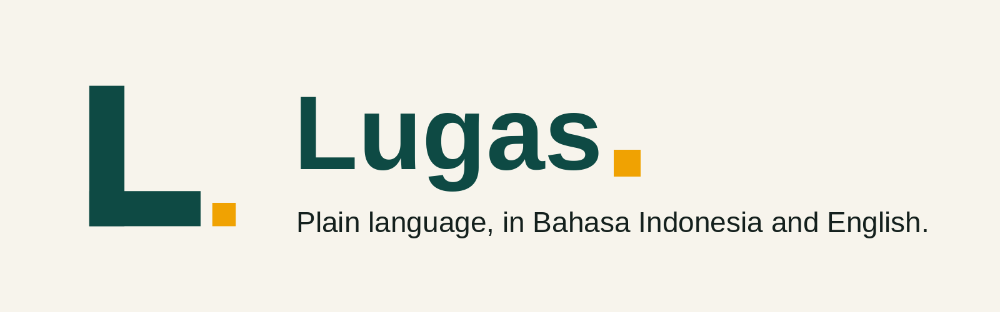

# Lugas



**Two agent skills that make AI write like a person, not a bureaucrat — in Bahasa Indonesia and English.**

[](https://github.com/rzlco666/lugas/stargazers)
[](LICENSE)
[](https://github.com/rzlco666/lugas/releases)
[](https://skills.sh/rzlco666/lugas)

> Plain language is not dumbing down. It is respect for the reader's time.

---

## Why Lugas?

AI writes stiff text. You have seen it: long sentences, words nobody says out loud, and apologies that apologize for nothing. Lugas fixes that — it gives your agent a repeatable way to write plainly, and a score that proves the rewrite is actually better.

- **AI text sounds translated, even in its own language.** Nominalizations, stacked passives, and filler phrases pile up until the reader gives up.
- **"Clear" is usually a feeling, not a check.** Lugas scores every rewrite on four dimensions, so "better" is a number, not a vibe.
- **Good writing rules live in one place.** Instead of pasting the same prompt into every chat, install the skill once and every agent you use writes plainly.

**Bahasa Indonesia**

> ❌ *Sehubungan dengan hal tersebut di atas, dengan ini kami sampaikan bahwa pelaksanaan kegiatan dimaksud akan dilaksanakan pada tanggal yang telah ditetapkan sebelumnya.*
>
> ✅ *Kegiatan ini jadi tanggal 12 November 2026.*

**English**

> ❌ *It is imperative that all stakeholders ensure compliance with the aforementioned directives in a timely manner.*
>
> ✅ *Please follow these rules by Friday.*

## See it work

One stiff paragraph, rewritten by the skill — with the score, not just the claim.

**Before** — a service outage notice, as most AIs write it:

> Dear Valued User, please be advised that, due to unforeseen circumstances beyond our control, the aforementioned service will be temporarily unavailable for a period of indeterminate duration, during which time users may experience an inability to access certain functionalities. We sincerely apologize for any inconvenience that may have been caused and appreciate your continued patience and understanding in this matter.

**After** — the same message, plain:

> Our service is down right now. We don't know yet when it will be back — we'll update this page every 30 minutes. Your data is safe, and nothing you saved is lost. Sorry for the trouble.

| RASA dimension | Before | After |
|---|---|---|
| Rhythmic — does it read well aloud? | 0 | 2 |
| Accurate — is every word on target? | 1 | 2 |
| Substantive — does every line carry meaning? | 0 | 2 |
| Authentic — does it sound like a person? | 0 | 2 |
| **Total** | **1 / 8 — fail** | **8 / 8 — pass** |

Nothing was lost: the downtime, the unknown return time, the apology — all still there. What went away was the filler. The rubric is **RASA** (Rhythmic, Accurate, Substantive, Authentic), scored 0–2 per dimension. A rewrite passes at **≥ 6/8 with no zero**. The name comes from Indonesian *rasa*: taste, feeling, meaning.

## Skills

| Skill | Covers | Pick it for |
|---|---|---|
| `bahasa-indonesia-plain` | Plain Bahasa Indonesia: short sentences, natural rhythm, correct EYD, no bureaucratic filler | Any Indonesian text — announcements, letters, reports, chat replies, public-service content |
| `english-plain` | Plain English: short sentences, active voice, everyday words, no jargon | Any English text — emails, docs, error messages, onboarding, marketing copy |

### Which skill do I need?

- Writing in Indonesian? → `bahasa-indonesia-plain`.
- Writing in English? → `english-plain`.
- Both, or translating between them? → install both; each skill keeps its own language's rules, so meaning survives the crossing.

Each skill ships with a scored RASA rubric, a word-swap table, copy-paste templates (errors, empty states, confirmations, onboarding), and a rewrite library of before/after pairs. See the worked examples in [`examples/`](examples/).

## Install

One command, your pick of route. Every route installs the same two skills.

### skills.sh (recommended)

```bash
npx skills add rzlco666/lugas
```

### Installer script

```bash
curl -fsSL https://raw.githubusercontent.com/rzlco666/lugas/main/install.sh | bash
```

Or clone and run locally:

```bash
git clone https://github.com/rzlco666/lugas.git
cd lugas
./install.sh
```

The installer detects the agents you have and copies the skills into their folders (`--skills id` / `--skills en` for one skill only, `--project` for project scope). See [GUIDE.md](GUIDE.md) for every flag.

### Claude Code (plugin)

```
/plugin marketplace add https://github.com/rzlco666/lugas
/plugin install lugas@lugas
```

### Codex

```bash
codex plugin marketplace add rzlco666/lugas
codex plugin add lugas@lugas
```

### Cursor

```bash
agent plugin marketplace add https://github.com/rzlco666/lugas
```

Then enable `lugas` in Cursor's plugin settings and restart Cursor.

### Cline

```bash
cline plugin install https://github.com/rzlco666/lugas.git
```

### Kimi Code

```
/plugins install https://github.com/rzlco666/lugas
```

### Oh My Pi

```bash
omp plugin marketplace add rzlco666/lugas
omp plugin install lugas@lugas
```

### Pi package

```bash
pi install git:github.com/rzlco666/lugas
```

### Single files (no install)

One skill, one file — paste it into any chat, or save it as `SKILL.md` wherever your agent reads skills from:

```bash
curl -o plain-id.md https://raw.githubusercontent.com/rzlco666/lugas/main/plain-id.md
curl -o plain-en.md https://raw.githubusercontent.com/rzlco666/lugas/main/plain-en.md
```

Full walkthrough per agent, global vs project scope, and troubleshooting: [GUIDE.md](GUIDE.md).

## Usage

Mention the skill by name in chat:

**Bahasa Indonesia**

```
pakai bahasa-indonesia-plain untuk menulis ulang pengumuman ini
```

```
cek surat ini dengan bahasa-indonesia-plain sebelum dikirim
```

**English**

```
use english-plain to rewrite this error message
```

```
review this onboarding email with english-plain and show me the RASA scores
```

### Two modes

- **Write** — draft new text in plain language from the start. The skill asks which mode you want the first time it runs in a session.
- **Review** — audit text that already exists. You get a numbered findings list, pick which ones to fix, and the skill fixes only those — then reports back.

### What you get back

Every finished rewrite ends with a short delivery report, so you can check the work instead of trusting it:

```text
RASA: Rhythmic 2, Accurate 2, Substantive 2, Authentic 1 — 7/8, pass.
Changed: cut 3 filler phrases, split 2 long sentences, active voice throughout.
Kept: the formal greeting — the audience is a government office, and
dropping it would change the tone, not the clarity.
```

## Who is this for

- **Developers** who want their AI pair-programmer to write UI copy and docs that read like a human wrote them.
- **Product teams** shipping onboarding, error messages, and empty states people actually understand.
- **Public-service teams** writing announcements, letters, and guides for everyone — including readers with low literacy, dyslexia, or screen readers.
- **Indonesian teams** writing in Bahasa Indonesia without the bureaucratic filler — and in English without the translated feel.
- **Non-native English readers** (and anyone writing for them): short sentences, literal wording, no idioms that die in translation.

## Star history

[](https://star-history.com/#rzlco666/lugas&Date)

If Lugas made your text clearer, a star helps other people find it. A fork with a better example helps even more.

## Contributors

Thanks to everyone who helps make plain language better.

[](https://github.com/rzlco666/lugas/graphs/contributors)

Want to contribute? See [CONTRIBUTING.md](CONTRIBUTING.md) — new rewrite examples are the best first contribution.

## FAQ

**Is this a style guide?**
No — it is a working skill. A style guide is a document you read once; Lugas tells the agent exactly how to rewrite and how to score the result, so the output is checked every single time.

**Does it change the meaning of my text?**
No. Accuracy is a scored dimension: a rewrite that changes the meaning fails, however smooth it sounds. The skill keeps all facts, numbers, and dates — it only cuts the words around them.

**Can I use one skill only?**
Yes. Install with `./install.sh --skills id` or `--skills en`, or download just the single file you need (`plain-id.md` or `plain-en.md`).

**What is RASA?**
A four-dimension rubric — Rhythmic, Accurate, Substantive, Authentic — scored 0–2 each. Pass is 6/8 with no zero. The name comes from Indonesian *rasa*: taste, feeling, meaning. Good writing should have all three.

**Does it work with my agent?**
If your agent reads `SKILL.md` files, loads plugins, or accepts pasted instructions, yes. Claude Code, Codex, Cursor, Cline, Kimi Code, Oh My Pi, and Pi are covered in [Install](#install); anything else can use the single files.

**Does it work on long documents?**
Yes. Long text is rewritten section by section, each section scored, so nothing slips through unreviewed.

**How is this different from a "write clearly" prompt?**
A prompt is a wish. A skill is a procedure: a workflow, a word-swap table, templates, a rewrite library, and a scored check at the end. Same input, same quality, every time.

**Is it free?**
Yes. MIT licensed, no paywall, no account, no token or coin. Fork it, improve it, use it in commercial products.

## Roadmap

What is next: logo and brand assets, CI validation, and skill upgrades are landing in **v1.1.0**; after that, more rewrite examples, templates for legal and finance text, and a third skill are on the table. The full list — with what is planned and what is just an idea — is in [ROADMAP.md](ROADMAP.md). What changed in each release is in [CHANGELOG.md](CHANGELOG.md).

## Contributing

New rewrite examples, sharper rules, fixes, and translations of the guide are all welcome. Every content PR must carry a before/after pair and RASA scores — see [CONTRIBUTING.md](CONTRIBUTING.md).

## License

MIT — see [LICENSE](LICENSE).

## Disclaimer

Get Lugas from [rzlco666/lugas](https://github.com/rzlco666/lugas) or its `skills.sh` listing. There is no Lugas coin, token, or fundraise. Any crypto coin, token, NFT, or fundraising that uses the Lugas name was not created by this project.

## Bahasa Indonesia

**Lugas** adalah dua skill agen AI yang membuat tulisan mudah dipahami siapa pun pada bacaan pertama — dalam Bahasa Indonesia dan Inggris. Setiap hasil tulis dinilai dengan kerangka **RASA**: **Ritmis, Akurat, Sarat Makna, Alami** (dari kata *rasa*: rasa, perasaan, makna).

Cara pakai: sebut nama skill di chat, misalnya *"pakai bahasa-indonesia-plain untuk menulis ulang pengumuman ini"*. Instalasi satu perintah — lihat bagian Install di atas. Lisensi MIT, gratis, tanpa token atau koin apa pun.
